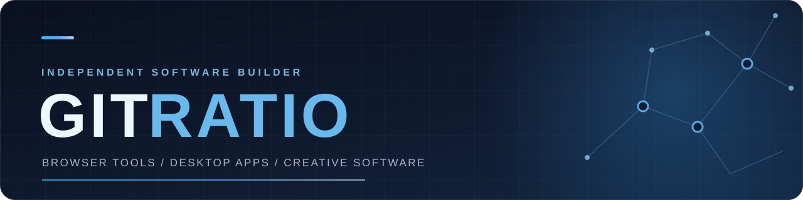

  
    
  
  <h2>Hey, I'm Constantino.</h2>
  
<strong>I build software that feels fast, purposeful, and approachable.</strong>

  
Firefox extensions · Desktop experiences · Developer tools · Anime discovery

  

    <a href="https://constantinoarango.com">Portfolio</a> &nbsp;·&nbsp;
    <a href="https://addons.mozilla.org/en-US/firefox/user/20056997/">Firefox add-ons</a> &nbsp;·&nbsp;
    <a href="https://github.com/GitRatio?tab=repositories">Repositories</a> &nbsp;·&nbsp;
    <a href="https://ko-fi.com/constantino_arango">Support my work</a>
  

---

### The work

I design and develop practical applications, from privacy-minded browser extensions to native desktop software. I care about **performance**, **user control**, **accessible interfaces**, and shipping software people can actually use.

| Project | What it does | Explore |
| :--- | :--- | :--- |
| **BlockWave Free** | Firefox ad and tracker blocking with user-friendly controls and repair options. | [Firefox add-on](https://addons.mozilla.org/en-US/firefox/addon/blockwave-free-adblocker/) |
| **RamRatio** | Adaptive Firefox tab and memory management, with optional system-level insights. | [Firefox add-on](https://addons.mozilla.org/en-US/firefox/addon/ramratio/) |
| **AniRatio** | Desktop anime browsing, library organization, and rich media discovery. | [Public download repository](https://github.com/GitRatio/AniRatio-Downloads) |
| **RamRatio Desktop Helper** | Opt-in native messaging companion for system and Firefox memory reporting. | [Source & documentation](https://github.com/GitRatio/RamRatio-Desktop-Helper) |
| **Personal portfolio** | My projects, background, and a way to get in touch. | [Visit website](https://constantinoarango.com) |

### Tools & technologies

`JavaScript` · `TypeScript` · `HTML/CSS` · `Python` · `C# / .NET` · `PowerShell`  
`Firefox WebExtensions` · `WebView2` · `Cloudflare` · `GitHub Actions`

### How I like to build

- **Lean by default.** Keep UI responsive and minimize unnecessary work.
- **Privacy and permission boundaries.** Make advanced capabilities explicit and optional.
- **Maintainable releases.** Favor clear architecture, reproducible packaging, and meaningful tests.

### Connect

Interested in collaboration, product feedback, or a look at the rest of my work? **[Visit my portfolio](https://constantinoarango.com)**. If one of my tools has been useful, you can **[support the next release](https://ko-fi.com/constantino_arango)**.

  Built with care · GitRatio / Constantino Arango

